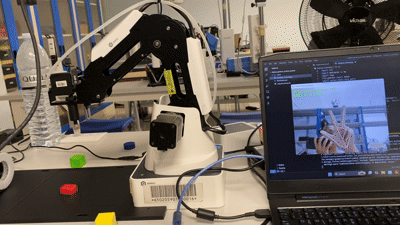

# Dobot Magician ควบคุมด้วยมือผ่าน webcam

ใช้มือบังคับ Dobot Magician ผ่านกล้อง webcam: ชี้นิ้วเพื่อเลื่อนแขนกล กำมือให้ลงไปดูดชิ้นงาน และแบมือให้ลงวางแล้วปล่อย ใช้กับ Magician รุ่นปกติที่ติดหัวดูด ต่อ USB กับ Windows x64 และรันด้วย Python 3.11



ภาพกล้องเป็นแบบกระจก มีโซนซ้าย ขวา บน ล่าง และพื้นที่กลางสำหรับหยุด โปรแกรมเปิดมาในสถานะพักเสมอ ต้องกดเริ่มเอง และไม่มีการทำ homing อัตโนมัติ

## วิธีบังคับ

| ท่ามือหรือตำแหน่งในภาพ | การทำงาน |
|---|---|
| ชี้นิ้วชี้ไปซ้ายหรือขวา | เลื่อนต่อเนื่องตามซ้ายหรือขวาของคนควบคุม |
| ชี้นิ้วชี้ไปด้านบน | เคลื่อนออกห่างคน |
| ชี้นิ้วชี้ไปด้านล่าง | เคลื่อนเข้าหาคน |
| ชี้นิ้วชี้กลางภาพ | หยุดเลื่อน |
| กำมือค้าง 0.5 วินาที ขณะยังไม่ถือของ | ลงหยิบ เปิดดูด รอ 0.5 วินาที แล้วยกกลับ |
| แบมือค้าง 0.5 วินาที ขณะถือของ | ลงวาง ปิดดูด รอ 0.5 วินาที แล้วยกกลับ |
| ท่าไม่ชัดเจนหรือท่าอื่น | หยุดเลื่อน |
| มือหาย เห็นสองมือ หรือภาพเก่า | หยุดและพัก รอกดเริ่มใหม่ |

โปรแกรมใช้จุดกลางฝ่ามือเลือกโซน พื้นที่หยุดตรงกลางกว้างและสูง 30% ของภาพ ขยับได้ทีละแกน ถ้ามืออยู่บนแนวทแยงพอดีจะหยุด ระหว่างเลื่อนแขนกลจะรักษาระดับเดินทางและมุมหัวดูดไว้

หลังหยิบหรือวางเสร็จ ต้องชี้นิ้วชี้ค้าง 0.5 วินาทีก่อนรับคำสั่งรอบใหม่ การกำมือค้างจะไม่สั่งหยิบซ้ำ กำมือขณะถือของและแบมือขณะว่างไม่มีผล

หันฝ่ามือเข้ากล้องให้เห็นนิ้วชัด เวลาชี้นิ้วให้พับนิ้วที่เหลือรวมถึงนิ้วโป้ง มือที่เอียงหรือพับนิ้วไม่ชัดอาจถูกอ่านเป็น `unknown` ให้ลองท่าใน SIMULATION ก่อนใช้กับแขนกล

## ติดตั้งบน Windows

ติดตั้ง Python 3.11 แบบ x64 แล้วเปิด PowerShell หรือ Command Prompt ในโฟลเดอร์โปรเจกต์:

```powershell
py -3.11 -m venv .venv
.venv\Scripts\python.exe -m pip install --upgrade pip
.venv\Scripts\python.exe -m pip install -r requirements.txt
.venv\Scripts\python.exe -m dobot_control --download-model
```

คำสั่งสุดท้ายดาวน์โหลดโมเดล Hand Landmarker ของ Google ขนาดประมาณ 8 MB ไปที่ `models/hand_landmarker.task` หลังติดตั้งและดาวน์โหลดโมเดลแล้ว การอ่านมือทำงานในเครื่อง ภาพกล้องไม่ถูกบันทึกหรือส่งออกไป

ใน venv นี้ใช้ `opencv-contrib-python` เพียงตัวเดียวตามที่ MediaPipe ต้องใช้ อย่าติดตั้ง `opencv-python` หรือรุ่น headless ซ้อนกัน

## ลองโหมดจำลอง

```powershell
.venv\Scripts\python.exe -m dobot_control
```

ค่าเริ่มต้นเป็น SIMULATION ใช้ webcam จริงแต่ไม่เชื่อมต่อแขนกล มีพื้นที่และระดับตัวอย่างให้ลองได้ทันที ชี้นิ้วชี้กลางภาพแล้วกด `S` ก่อนเริ่ม ใช้คีย์บอร์ดภาษาอังกฤษและคลิกหน้าต่างกล้องให้รับปุ่ม หากเปิดกล้องไม่ได้ลอง `--camera 1`

ถ้าต้องการลองลำดับหยิบวางโดยไม่ใช้กล้อง โมเดล หรือไลบรารีภายนอก:

```powershell
py -3.11 -m dobot_control --headless-demo
```

ผลลัพธ์ต้องมี `"pump_events": [true, false]`, `"state": "paused"` และ `"final_z": 50`

## ต่อ Dobot จริง

1. ติดตั้งไดรเวอร์ USB และทดสอบหัวดูดใน DobotStudio เลือกเครื่องมือเป็นหัวดูด ตั้งแขนไว้ในพื้นที่โล่ง แล้วปิด DobotStudio เพื่อคืนพอร์ต
2. ดูชื่อพอร์ตใน Windows Device Manager เช่น `COM3`
3. ดาวน์โหลด Dobot SDK Demo สำหรับ Magician รุ่นปกติจาก [ผู้ผลิต](https://www.dobot-robots.com/products/education/magician.html) ใช้ `DobotDllType.py` กับ Windows x64 DLL จากชุดเดียวกัน ตัวเชื่อมใช้คำสั่งแบบ `ConnectDobot(api, port, 115200)` ตาม [Dobot Demo Description](https://download.dobot.cc/product-manual/dobot-magician/Dobot%20Magician%20Demo%20Description.pdf)
4. วางไฟล์ตามโครงสร้างนี้ รวม DLL ประกอบที่มากับชุด Windows x64 อย่าผสม x86 หรือ SDK ของ Lite/E6:

```text
Dobot_hand_control/
  sdk/
    DobotDllType.py
    DobotDll.dll
    ... DLL ประกอบที่มากับชุดเดียวกัน ...
  models/
    hand_landmarker.task
```

รันโดยเปลี่ยนพอร์ตให้ตรงกับเครื่อง:

```powershell
.venv\Scripts\python.exe -m dobot_control --real --port COM3 --sdk-dir sdk
```

หากเก็บ SDK ไว้ที่อื่น ใช้ `--sdk-dir "C:\path\to\sdk"` ให้ชี้โฟลเดอร์ที่มี Python wrapper และ DLL ที่โหลดได้ โปรแกรมเรียก wrapper ใน process แยก

ครั้งแรกต้องสอนตำแหน่งจริงก่อน ค่าจาก SIMULATION ใช้สั่งแขนกลจริงไม่ได้ ทุกครั้งที่เชื่อมต่อใหม่ สถานะถือของเริ่มเป็น `UNKNOWN` ต้องมีค่าตั้งตำแหน่งจริงและยืนยันด้วย `E` หรือ `H` ก่อนเริ่ม การเชื่อมต่อจะร้องขอหยุดและล้างคิวค้าง โดยคงปั๊มไว้และไม่เคลื่อนกลับบ้าน

## สอนตำแหน่ง

กด `C` เพื่อเข้าโหมดสอน ท่ามือจะไม่มีผลระหว่างตั้งค่า ใช้คีย์บอร์ดขยับทีละ 1 มม. ที่ความเร็วสูงสุด 5 มม./วินาที รอให้เคลื่อนที่จบก่อนบันทึกแต่ละจุด

| ปุ่ม | การทำงาน |
|---|---|
| ลูกศรซ้าย/ขวา | ขยับตามแกนที่ตั้งเป็นซ้าย/ขวา |
| ลูกศรขึ้น/ลง | ขยับตามแกนที่ตั้งเป็นออกห่าง/เข้าหาคน |
| Page Up / Page Down | ยกสูง / ลดต่ำ |
| A | สลับการผูกแกน X กับ Y |
| X | กลับทิศซ้าย/ขวา |
| Y | กลับทิศออกห่าง/เข้าหาคน |
| T | บันทึก Z สำหรับเดินทาง |
| 1 / 2 | บันทึกมุมตรงข้ามของสี่เหลี่ยมพื้นที่ XY |
| P | บันทึก Z สำหรับหยิบ |
| L | บันทึก Z สำหรับวาง |
| W | ยืนยันว่าพื้นที่ทั้งสี่เหลี่ยมเอื้อมถึงและไม่มีสิ่งกีดขวาง |
| V | ตรวจและบันทึกลง `config.json` แล้วออกจากโหมดสอน |

ตั้งค่าตามลำดับนี้:

1. ยกหัวดูดให้พ้นสิ่งกีดขวาง แล้วกด `T` บันทึกระดับเดินทาง
2. ลองลูกศรทีละน้อยให้ทิศตรงกับคนที่ยืนควบคุม ใช้ `A/X/Y` ปรับตามตำแหน่งที่ตั้งแขนกล
3. ที่ระดับเดินทาง บันทึกมุม XY ด้วย `1` และ `2` เริ่มจากพื้นที่เล็ก ตรวจให้ทั้งสี่เหลี่ยมอยู่ในระยะเอื้อมและมีที่ว่างแนวดิ่งตลอดพื้นที่ สองมุมที่เอื้อมถึงยังไม่พอยืนยันว่าจุดข้างในเอื้อมถึงทั้งหมด
4. เลื่อนไปตำแหน่งหยิบ ใช้ Page Down ลงทีละน้อยจนหัวดูดแตะผิวบนชิ้นงานพอดี แล้วกด `P` สำหรับโต๊ะเดียวและของสูงเท่ากัน กด `L` ที่ระดับเดียวกันได้ หากวางต่างระดับให้บันทึกระดับวางจริง
5. เมื่อบันทึกครบ `1/2/T/P/L` และตรวจพื้นที่แล้ว กด `W` แล้ว `V` ถ้าบันทึกจุดเพิ่ม ต้องยืนยัน W ใหม่
6. ให้ตำแหน่งปัจจุบันอยู่ในขอบเขต XY และช่วง Z ที่สอน กด `E` หากว่าง หรือ `H` หากถือของ โปรแกรมจะตั้งปั๊มตามที่เลือกแล้วยกในแนวดิ่งถึงระดับเดินทาง
7. เมื่อยกเสร็จ ชี้นิ้วชี้กลางภาพแล้วกด `S`

`E` ปิดปั๊มและยืนยันว่าไม่มีของ ส่วน `H` เปิดปั๊มและยืนยันว่าถือของ เลือกให้ตรงกับสถานะจริง โหมดสอนยังไม่รู้ขอบเขต จึงให้ผู้ควบคุมขยับด้วยปุ่มครั้งละระยะสั้น โดยไม่ใช้ขอบเขตตัวอย่างแทนพื้นที่จริง

`config.example.json` เป็นตัวอย่างที่ยังไม่ได้สอบเทียบ ไม่ต้องคัดลอกก่อนใช้ โปรแกรมจะสร้าง `config.json` เมื่อสอนและบันทึกสำเร็จ ค่านี้ใช้กับตำแหน่งฐาน กล้อง โต๊ะ หัวดูด และชิ้นงานชุดเดิม หากย้ายหรือเปลี่ยนให้สอนใหม่

## เริ่ม หยุด และกู้ตำแหน่ง

| ปุ่ม | การทำงาน |
|---|---|
| S | เริ่ม ต้องเห็นมือเดียวชี้นิ้วกลางภาพ และแขนกลอยู่ในขอบเขตที่ระดับเดินทาง |
| Space | หยุดและพัก คงสถานะปั๊ม |
| C | เข้าโหมดสอนใหม่ ต้องบันทึกครบก่อนเริ่ม |
| E / H | ยืนยันไม่มีของ/มีของ แล้วกู้ตำแหน่งขึ้นระดับเดินทาง |
| Q หรือ Escape | หยุดแล้วออก คงสถานะปั๊ม |

ถ้าหยุดกลางการหยิบวาง โปรแกรมจะเข้า `recovery` และยกเลิกลำดับเดิม กด S เพื่อทำต่อไม่ได้ ต้องตรวจสถานะและใช้ `E/H` กู้ตำแหน่งก่อน ถ้าตำแหน่งอยู่นอกขอบเขต ให้เข้า `C` เพื่อสอนใหม่หรือจัดตำแหน่งด้วยปุ่ม

## ข้อจำกัดที่ต้องรู้ก่อนใช้

- ความเร็วแนวราบเริ่มที่ 10 มม./วินาที ส่งเป้าหมายครั้งละไม่เกิน 1 มม. มีคำสั่งเคลื่อนที่ค้างได้ครั้งเดียว และตรวจทั้งดัชนีคิวกับตำแหน่งก่อนส่งต่อ การหยิบวางก็แบ่งเป็นระยะสั้น แทนการส่งทั้งลำดับสะสมในคิว
- control thread ทำงานแยกจากกล้อง ตรวจภาพที่เก่าเกิน 300 มิลลิวินาทีและตรวจซ้ำก่อนส่งคำสั่ง การเรียก SDK ขณะทำงานมี timeout ไม่เกิน 200 มิลลิวินาที คำสั่งอัตโนมัติมี deadline ตามอายุภาพ ถ้า wrapper ค้าง โปรแกรมจะยุติ process เพื่อไม่ให้กลับมาส่งคำสั่งเก่า
- 300 มิลลิวินาทีเป็นเกณฑ์อายุภาพ ส่วนเวลาหยุดทางกายภาพขึ้นกับ Windows, SDK, USB และการเคลื่อนที่ที่เริ่มไปแล้ว
- ถ้า USB หลุดหรือ SDK ไม่ตอบ จะขึ้น `STOP NOT CONFIRMED` ต้องจัดการเครื่องจริงแล้วเปิดโปรแกรมใหม่ ตรวจสถานะและกู้ตำแหน่งก่อนเริ่ม Space เป็นคำสั่งหยุดผ่านซอฟต์แวร์ เมื่อสั่งไม่ได้ให้ใช้การหยุดของตัวเครื่อง
- `HOLDING` บอกสถานะตามคำสั่งปั๊ม ยังไม่มีเซนเซอร์ยืนยันว่าดูดของติดจริง โปรแกรมคงปั๊มไว้เมื่อมือหายหรือออกโปรแกรม เพื่อไม่ปล่อยของโดยไม่ตั้งใจ
- โหมดปกติใช้ Z ที่สอนและไม่หมุนหัวดูด ไม่มีการตรวจความสูงชิ้นงานหรือหลบสิ่งกีดขวางอัตโนมัติ

## ทดสอบ

การทดสอบตรรกะไม่ต้องมีอุปกรณ์หรือติดตั้ง requirements:

```powershell
py -3.11 -m unittest discover -s tests -v
py -3.11 -m dobot_control --headless-demo
```

ชุดทดสอบครอบคลุมโซน ท่ามือ การกลับภาพ การหน่วงท่า ลำดับหยิบวาง การหยุด ขอบเขต และการแยกค่าจำลองออกจากแขนกลจริง รวมถึงกล้องค้างขณะที่ control thread ยังทำงาน และ SDK จำลองที่ทำงานผ่าน process จริงทั้งกรณีปกติและกรณีค้าง

ก่อนใช้กับเครื่องจริง ให้ลองกล้องใน SIMULATION ตรวจทิศลูกศรทีละ 1 มม. และตรวจขอบเขต จากนั้นลองหยิบวางชิ้นเดียว ทดลอง Space ระหว่างแต่ละช่วงโดยเตรียมรองรับชิ้นงาน เมื่อหยุดแล้วโปรแกรมต้องไม่เริ่มใหม่หรือเปลี่ยนปั๊มเอง

ยังต้องตรวจกล้อง ชุด SDK/DLL และการเคลื่อนที่บน Windows ที่ต่ออุปกรณ์จริง โดยเฉพาะทิศแกน ระดับหัวดูด และการหยุดทางกายภาพ ผลตรวจในสภาพแวดล้อมพัฒนาอยู่ที่ `docs/implementation.md`

## แหล่งอ้างอิง

- [Dobot Magician API](https://download.dobot.cc/product-manual/dobot-magician/pdf/en/Dobot-Magician-API-DescriptionV1.2.3.pdf)
- [MediaPipe Hand Landmarker](https://developers.google.com/edge/mediapipe/solutions/vision/hand_landmarker?tab=Python)
- [MediaPipe 0.10.21 สำหรับ Python](https://pypi.org/project/mediapipe/0.10.21/)
- [OpenCV Python: เลือกแพ็กเกจ cv2 เพียงตัวเดียว](https://pypi.org/project/opencv-contrib-python/4.11.0.86/)
